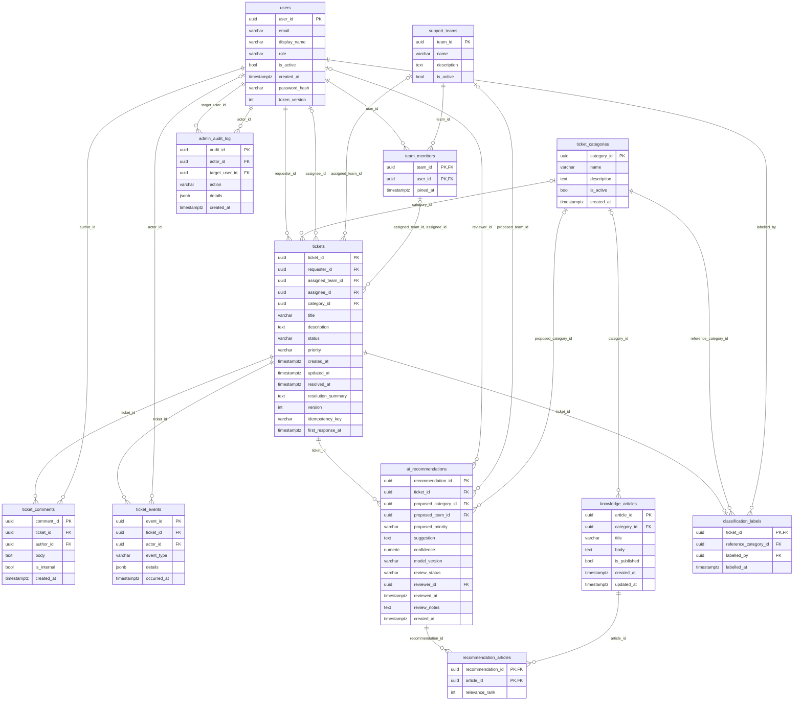

<!-- Generated from schema-spec.json by `npm run docs:db -w backend`. Do not edit by hand. -->

# Entity-relationship diagram

The eleven core SmartDesk entities as deployed by the Prisma migrations. Field details are in
[data-dictionary.md](./data-dictionary.md); rules and enumerations are in [README.md](./README.md).

## Relationships

Cardinality is `parent : child`. Every foreign key is `ON DELETE RESTRICT`: history is deactivated,
never cascaded away. `tickets` references `users` twice (requester and assignee) and `team_members`
through the composite key `(assigned_team_id, assignee_id)`, which guarantees the assignee belongs to
the assigned team.

| Child table | Foreign key | Parent | Cardinality | Presence | On delete |
| --- | --- | --- | --- | --- | --- |
| `team_members` | `team_id` | `support_teams` (`team_id`) | 1 : N | required | RESTRICT |
| `team_members` | `user_id` | `users` (`user_id`) | 1 : N | required | RESTRICT |
| `tickets` | `assigned_team_id, assignee_id` | `team_members` (`team_id, user_id`) | 0..1 : N | optional | RESTRICT |
| `tickets` | `assigned_team_id` | `support_teams` (`team_id`) | 0..1 : N | optional | RESTRICT |
| `tickets` | `assignee_id` | `users` (`user_id`) | 0..1 : N | optional | RESTRICT |
| `tickets` | `category_id` | `ticket_categories` (`category_id`) | 0..1 : N | optional | RESTRICT |
| `tickets` | `requester_id` | `users` (`user_id`) | 1 : N | required | RESTRICT |
| `ticket_comments` | `author_id` | `users` (`user_id`) | 1 : N | required | RESTRICT |
| `ticket_comments` | `ticket_id` | `tickets` (`ticket_id`) | 1 : N | required | RESTRICT |
| `ticket_events` | `actor_id` | `users` (`user_id`) | 0..1 : N | optional | RESTRICT |
| `ticket_events` | `ticket_id` | `tickets` (`ticket_id`) | 1 : N | required | RESTRICT |
| `ai_recommendations` | `proposed_category_id` | `ticket_categories` (`category_id`) | 0..1 : N | optional | RESTRICT |
| `ai_recommendations` | `proposed_team_id` | `support_teams` (`team_id`) | 0..1 : N | optional | RESTRICT |
| `ai_recommendations` | `reviewer_id` | `users` (`user_id`) | 0..1 : N | optional | RESTRICT |
| `ai_recommendations` | `ticket_id` | `tickets` (`ticket_id`) | 1 : N | required | RESTRICT |
| `knowledge_articles` | `category_id` | `ticket_categories` (`category_id`) | 0..1 : N | optional | RESTRICT |
| `recommendation_articles` | `article_id` | `knowledge_articles` (`article_id`) | 1 : N | required | RESTRICT |
| `recommendation_articles` | `recommendation_id` | `ai_recommendations` (`recommendation_id`) | 1 : N | required | RESTRICT |
| `classification_labels` | `labelled_by` | `users` (`user_id`) | 1 : N | required | RESTRICT |
| `classification_labels` | `reference_category_id` | `ticket_categories` (`category_id`) | 1 : N | required | RESTRICT |
| `classification_labels` | `ticket_id` | `tickets` (`ticket_id`) | 1 : 0..1 | required | RESTRICT |
| `admin_audit_log` | `actor_id` | `users` (`user_id`) | 1 : N | required | RESTRICT |
| `admin_audit_log` | `target_user_id` | `users` (`user_id`) | 1 : N | required | RESTRICT |
